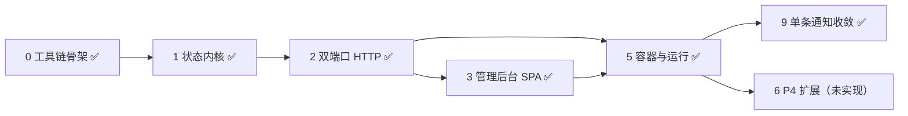

# 交付计划

本目录记录实施任务与进度；页面、状态、管理后台及 API 的目标契约以 [项目 README](../README.md) 为准。已经发生的变更记录到 [changelog](../changelog/README.md)，不能把计划写成已交付能力。

当前状态（2026-10-30）：

- **已完成**：阶段 0 工具链、阶段 1 状态内核、阶段 2 双端口 HTTP、阶段 3 单页管理后台、阶段 5 容器与运行、阶段 9 单条通知收敛。
- **未实现**：阶段 6/P4 的 `/flaky`、`/slow`、单页覆盖与安全探针；不阻塞当前使用。
- **已作废**：阶段 4（列表与 CSR）随单条通知收敛删除；P2 同此。
- **历史记录**：阶段 7（真实商品详情页与向导式后台）、阶段 8（移除结构性破坏场景）保留为历史，对应实现已被后续需求替换或删除。
- **构建方式**：只从本仓库源码构建，不发布 GHCR 镜像。

首轮交付按 P1 + P3 验收；管理后台是必交付内容。P4 不阻塞首轮。

## 实施阶段

按依赖顺序推进。阶段 0–3、5、6、9 是可执行的落地顺序（阶段 4 已作废），P1–P4 是验收分组：P1 = 阶段 0–3，P2 = 阶段 4（已作废），P3 = 阶段 5，P4 = 阶段 6。

| 阶段 | 产出 | 关键约束 | 状态 |
|---|---|---|---|
| 0 工具链骨架 | `pyproject.toml`、`requirements.txt`、`.gitignore`、`web/package.json` + `pnpm-lock.yaml`、`deploy/dev.Dockerfile`、`compose.yaml`（dev 服务） | Python `>=3.12,<3.13` 装进镜像，不在宿主建 venv；Python 依赖无锁文件，由 `uv pip compile --generate-hashes` 从 `pyproject.toml` 生成；pnpm 版本写入 `packageManager` 并由 pnpm 生成锁文件 | 已完成 |
| 1 状态内核 | `src/mocksite/state/{models,patch,store,errors}.py`、`scenarios/registry.py` | 纯逻辑无 HTTP；校验、提交、版本递增、静态页重渲在同一次锁内完成 | 已完成 |
| 2 双端口 HTTP | `src/mocksite/{cli,config}.py`、`admin/{auth,api}.py`、`site/{render,routes,pages}.py`、`site/templates/notice.html` | 单进程、两个监听器共享同一个 `StateStore`，禁止多 worker；9001 不挂站点路由 | 已完成 |
| 3 管理后台 SPA | `web/admin/src/**`（`lib/api.ts`、`components/ui.tsx`、`features/{connection,state,scenarios,preview}`） | token 只存页面内存；同源调用 `/_admin/*`；失败保留表单内容 | 已完成 |
| 4 列表与 CSR | 列表页、分页、React/Vue 运行时 | 随阶段 9 删除 | 已作废 |
| 5 容器与运行 | `deploy/Dockerfile`、`compose.yaml`、`compose.dev.yaml`、`.env.example`、`scripts/control.py` | 非 root、只读根文件系统；基础 Compose 不发布 9001，dev overlay 才映射 `127.0.0.1:9001` | 已完成 |
| 6 P4 扩展 | `/flaky`、`/slow`、单页覆盖、安全探针 | 确定性序列与计数，reset 清零；探针只接受固定枚举 | **未实现** |
| 7 真实详情页与向导式后台 | 商品详情页、四步向导、诱饵金额 | 已被阶段 8/9 取代 | 历史 |
| 8 移除结构性破坏场景 | 删除 `Presentation`、结构性场景、呈现面板 | 数据切换与结构破坏分离 | 历史 |
| 9 单条通知收敛 | 删除列表、分页、React/Vue；后台改单页；场景降为 8 个 | 只服务“盯住一条通知”的真实用法 | 已完成 |

## 已完成事项与证据

### 阶段 0：工具链骨架

- [x] `pyproject.toml`（hatchling、`src` 布局、精确 pin）、`.gitignore`、`.dockerignore`。
- [x] `web/package.json` 固定 `pnpm@12.15.0`，提交 `pnpm-lock.yaml`；管理后台与目标页共用一份清单。
- [x] `deploy/dev.Dockerfile`：Python 3.12 + Node 22 + pnpm，非 root，依赖安装与前端构建都在容器内。
- 证据：容器内 `python -c "import mocksite"`、`pnpm install --frozen-lockfile` 成功（2026-10-25 记录）。

### 阶段 1：状态内核

- [x] `state/models.py`：单条通知的不可变模型，`extra="forbid"`；金额 `Decimal` ↔ 十进制字符串；`published_at` 分钟精度；`status` 为 `published|withdrawn`；正文段落与附件有上限。
- [x] `state/patch.py`：对象递归合并、数组整体替换；`null`、`revision`、未知 section/key、类型错误全部拒绝，一次返回全部错误。
- [x] `state/store.py`：`patch` / `apply_scenario` / `reset` 均在同一把锁内完成“递增 revision → 渲染 → 同时替换 state 与 static_html”；渲染失败不推进状态。
- [x] `scenarios/registry.py`：8 个绝对场景，分组 `baseline|fee|content`；重复应用只推进版本，场景不叠加。
- 证据：`tests/unit/test_state_models.py`、`test_state_patch.py`、`test_state_store.py`、`test_scenarios.py`；容器内 `pytest -q` 通过（历史记录）。

### 阶段 2：双端口 HTTP

- [x] `cli.py` 在同一事件循环内托管两个 `uvicorn.Server`，共享一个 `StateStore`；只有站点 server 安装信号处理器；任一退出即取消另一个。
- [x] 管理端口：Bearer 认证（常量时间比较，弱 token 拒绝启动）、`GET/PATCH /_admin/state`、`POST /_admin/reset`、`GET /_admin/scenarios`、`POST /_admin/scenario/{name}`、`GET /_admin/meta`。
- [x] 站点端口：`/static/notice`（预渲染）、`/ssr/notice`（按快照渲染）、`/api/views`、`/health`、`/static/shared` 挂载；全部业务响应带 `X-Mocksite-Revision` 与 `no-store`。
- [x] 请求体上限 64 KiB、只接受 `application/json`、日志不输出 Authorization 与请求体。
- 证据：`tests/integration/test_admin_http.py`、`test_admin_meta.py`、`test_notice_http.py`、`test_site_http.py`；真实进程双端口探测（2026-10-25/26 记录）。

### 阶段 3：单页管理后台

- [x] 连接与认证：token 只存模块内存，刷新/退出清除，不写 `localStorage`/URL。
- [x] 单页控制台：场景分组卡片（基线/收费标准/通知内容）、通知字段编辑、右侧实时预览、事实摘要、刷新/恢复默认/退出。
- [x] 场景文案由 `GET /_admin/scenarios` 提供，后台不复制第二份；应用前二次确认，成功后显示 `revision N → N+1`。
- [x] 操作反馈：提交中禁用、字段错误映射到输入框、401 回连接页、失败保留草稿。
- 证据：`tests/acceptance/check_admin_ui.py`，2026-10-26 记录 38/38。

### 阶段 5：容器与运行

- [x] `deploy/Dockerfile` 两阶段构建：Node 阶段冻结安装并 `pnpm build`；Python 阶段 hash 安装依赖、安装含 `_static/shared` 的 wheel，以 UID `10001` 运行。
- [x] `compose.yaml` 的 `site` 服务 `read_only: true` + `tmpfs: /tmp`，只发布 `127.0.0.1:9000`；`dev` 服务在 `tools` profile 下，不发布端口。
- [x] `compose.dev.yaml` 只追加 `127.0.0.1:9001`，供浏览器打开后台。
- [x] `scripts/control.py`：`state`/`scenarios`/`pages`/`reset`/`scenario`/`patch`，退出码 0/1/2；对 loopback 绕过 `*_proxy`。
- [x] Agent 接入说明：由 Agent 部署方把 `egress` 接入与 mocksite 共享的 Compose 网络，并自行配置只放行 `site:9000` 的出口白名单与 target allowlist；本仓库不提供 Agent 专用 overlay 或专用 Squid 配置，也不维护按平台划分的接入目录。
- 证据：基础 Compose 下宿主机直连 9001 被拒绝、overlay 下可访问；容器内 `site:9000`/`site:9001` 可解析（2026-10-25 记录）。

### 阶段 9：单条通知收敛

- [x] 删除 `/react/list`、`/vue/list`、`/dynamic/archive`、`/api/data` 与 `/static/{react,vue}` 挂载；只保留通知页、点击次数、健康检查与 `/static/shared`。
- [x] 删除 `Entry`、`entries`、`page_size`、`page_count`；`BusinessData` 只剩 `notice`。
- [x] 删除 `render_list`、`render_archive`、`entries_wire`、`VENDOR_REACT`、`VENDOR_VUE`、`list.html`、`archive.html` 与 React/Vue 资产。
- [x] 场景从 11 个降为 8 个，分组从 4 个降为 3 个；删除 `empty_list`、`duplicate_rows`、`pagination_grow`。
- [x] 管理后台从四步向导改为单页控制台；删除选择器参考表、字段级 diff、列表编辑与呈现控制。
- [x] 测试与两个浏览器验收脚本按新界面重写。
- 证据：2026-10-26 记录 `pytest -q` → 266 passed（204 unit + 62 integration）；`check_admin_ui.py` 38/38；`check_target_pages.py` 47/47。

## 未实现事项

### 阶段 6 / P4

- [ ] `/flaky` 固定序列与按端点计数，reset 清零。
- [ ] `/slow?ms=` 仅影响当前请求，边界 0–30000，非法输入 400。
- [ ] `/redirect-private?target=` 与 `/private-resource`，只接受固定枚举。
- [ ] 单页覆盖（相同操作序列作用于多个页面时互不泄漏）。

这些能力没有代码、没有测试、没有文档化命令；在完成前不得在 README 或 changelog 中描述为可用。

## 验收分组

### P1：管理后台与通知页面（已完成）

- [x] 单进程状态管理、输入校验、原子提交、版本递增与 reset。
- [x] 独立管理端口、Bearer 认证、管理 API 与 `/_admin/meta`。
- [x] static/SSR 通知页、稳定选择器、响应版本标记。
- [x] 8 个数据场景与通知字段编辑。
- [x] 真实浏览器完成“默认标准 → 修改 → 恢复”，非法写入不改变状态。
- 证据：`tests/acceptance/check_admin_ui.py`、`check_target_pages.py`（2026-10-26）。

### P2：列表与 CSR（已作废）

2026-10-26 起本组作废：列表页、分页与 React/Vue 运行时已删除，站点只提供一条通知。历史记录保留在 changelog，不再作为验收项。

### P3：容器与运行（已完成）

- [x] Dockerfile、基础 Compose、开发 overlay、控制脚本、Agent 接入说明。
- [x] 启动、后台认证、管理请求、关闭文档。
- [x] 管理端口无基础发布；采集方地址与预览地址分离。
- [x] 浏览器验收覆盖认证、场景、编辑、reset 与离线加载。
- [x] 文档化 Agent 接入方式：共享网络与精准出口白名单由 Agent 部署方配置；本仓库不提供专用 overlay，Agent 端到端结果由 Agent 仓库记录，本仓库不冒充已验证。
- 证据：README §7；2026-10-25/26 changelog 中的 Compose 与浏览器实测记录。

### P4：后续扩展（未实现）

- [ ] 确定性失败序列与计数器重置。
- [ ] 单请求延迟及参数边界校验。
- [ ] 固定私网重定向和子资源探针。
- [ ] 单页覆盖。

## 已知前置阻塞

当前没有阻塞阶段 0–3、5、9 的前置条件。此前的两条已关闭：

1. ~~Agent 出口例外硬编码~~：不属于本仓库职责；Agent 部署方自行把 `egress` 接入共享网络，并在自己的出口与 target allowlist 中只放行 `site:9000`，本仓库不提供专用 overlay。
2. ~~选择器契约要求表格结构~~：随列表页删除；选择器只覆盖通知详情页。

## 维护方式

- 只在实现与对应验收都完成后勾选任务，并附证据位置（测试文件、changelog 日期）。
- 需求变化同时更新 README 契约、本计划与 changelog，避免三处描述冲突。
- 纯文档整理不新增 `YYYY-MM-DD.md` 时，直接记入 [changelog 索引](../changelog/README.md)，并明确是否运行过验证。
- 历史 changelog 保留当日实测数字；当前能力以 README 为准，不把历史数字改写成“现在仍然如此”。
