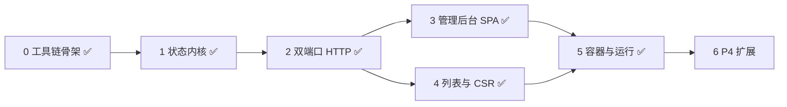

# 交付计划

本目录记录实施任务与进度；页面、状态、管理后台及 API 的目标契约以 [项目 README](../README.md) 为准。变更已经发生后记录到 [changelog](../changelog/README.md)，不能把计划写成已交付能力。

当前状态：阶段 0–5 已完成，站点可一条命令启动；商品详情页已重构为真实电商结构，管理后台已重设计为向导式并内嵌实时预览（见 2026-10-25 变更记录）。`pyproject.toml`、`web/package.json` + `pnpm-lock.yaml`、`deploy/dev.Dockerfile`、`compose.yaml` 的 `dev` 服务、`src/mocksite/state/`、`src/mocksite/scenarios/`、`src/mocksite/{config,cli}.py`、`admin/{auth,api}.py`、`site/{render,routes}.py` 已落地，进程可实际启动并响应两个端口；阶段 6 的扩展故障与安全探针仍待实现。首轮交付包含 P1–P3，管理后台是必交付内容。

## 实施阶段

按依赖顺序推进。阶段 0–6 是可执行的落地顺序，P1–P4 是验收分组：P1 = 阶段 0–3，P2 = 阶段 4，P3 = 阶段 5，P4 = 阶段 6。

| 阶段 | 产出 | 关键约束 | 完成标准 |
|---|---|---|---|
| 0 工具链骨架 | `pyproject.toml`、`requirements*.txt`、`.gitignore`、`web/package.json` + `pnpm-lock.yaml`、`deploy/dev.Dockerfile`、`compose.yaml`（dev 服务） | Python `>=3.12,<3.13` 装进镜像，不在宿主建 venv；Python 依赖无锁文件，由 `uv pip compile --generate-hashes` 从 `pyproject.toml` 生成；pnpm 版本写入 `packageManager` 并由 pnpm 生成锁文件 | 容器内 `python -c "import mocksite"` 与 `pnpm install --frozen-lockfile` 均成功 |
| 1 状态内核 ✅ | `src/mocksite/state/{models,patch,store,errors}.py`、`scenarios/registry.py` | 纯逻辑无 HTTP；校验、提交、版本递增、静态页重渲在同一次锁内完成 | `tests/unit` 通过；非法输入不改变状态也不推进版本 |
| 2 双端口 HTTP ✅ | `src/mocksite/cli.py`、`config.py`、`admin/{auth,api}.py`、`site/{render,routes}.py`、`site/templates/*` | 单进程、两个监听器共享同一个 `StateStore`，禁止多 worker；9001 不挂站点路由 | 401/415/413/400 与 `no-store`、`X-Mocksite-Revision` 符合 §5.2 |
| 3 管理后台 SPA ✅ | `web/admin/src/**`（`lib/api.ts`、`components/ui.tsx`、`features/{connection,state,scenarios,targets}`） | token 只存页面内存；同源调用 `/_admin/*`；失败保留表单内容 | 真实浏览器完成“默认价 → 修改 → 恢复”；500 期间仍能恢复 |
| 4 列表与 CSR ✅ | `site/static/{vendor,assets}/`、`site/templates/{list,deals}.html`、`/react/list`、`/vue/list`、`/dynamic/deals` | 本地 UMD 资产、无 CDN；行必须是 `<table>` 结构以匹配 §3.3 选择器 | 浏览器离线渲染；分页得到完整有序 ID；空列表、加载失败、字段缺失、重复行可区分 |
| 5 容器与运行 ✅ | `deploy/Dockerfile`、`compose.yaml`、`compose.dev.yaml`、`.env.example`、`scripts/control.py` | 非 root、只读根文件系统；基础 Compose 不发布 9001，dev overlay 才映射 `127.0.0.1:9001` | 一条命令启动并访问后台；两个平台分别完成基线、变化、故障、恢复 |
| 6 P4 扩展 | `/flaky`、`/slow`、单页覆盖、安全探针 | 确定性序列与计数，reset 清零；探针只接受固定枚举 | 相同序列产生相同响应；受限地址未被访问（出口或探针计数证据） |

### 阶段 0：工具链骨架

- [x] 创建 `pyproject.toml`（hatchling，包 `mocksite`，源码根 `src`）与 `.gitignore`（`__pycache__`、`.venv`、`node_modules`、构建产物、本地 `.env`）。
- [x] 在 `web/package.json` 写入 `packageManager` 固定 pnpm 精确版本，生成并提交 `pnpm-lock.yaml`；管理后台与 React/Vue 目标页共用这一份清单。
- [x] 提供 dev 工具链 Dockerfile（Python 3.12 + Node 22 + pnpm），依赖安装与前端构建都在容器内执行，部署构建使用冻结锁文件。

### 阶段 1：状态内核

- [x] 定义状态模型：业务数据（商品、列表、`page_size`）、互斥呈现枚举、故障项、只读 `revision`。
  `src/mocksite/state/models.py`：`State`/`BusinessData`/`Product`/`Item`/`Presentation`/`Faults`，全部 frozen + `extra="forbid"`；价格用 `Decimal` + 前后置校验（仅接受 `<digits>[.<digits>]` 字符串，拒绝浮点、指数、负号、非有限值、>64 字符），序列化为十进制字符串；`page_count` 派生不存储。
- [x] 实现 `PATCH` 语义：对象递归合并、数组整体替换、`null` 与未知键报错。
  `src/mocksite/state/patch.py`：`null`、任意深度的 `revision`、未知 section/key 全部拒绝并给出 `loc`；一次返回全部错误。
- [x] 实现锁内的“校验 → 静态页渲染 → 提交 → 版本递增”，保证不存在状态已更新而静态页仍旧的窗口。
  `src/mocksite/state/store.py`：`_commit_locked` 在同一把锁内完成“递增 revision → 渲染 → 同时替换 state 与 static_html”；渲染抛错时状态与页面都不前进（`test_renderer_failure_does_not_advance_state_or_page`、`test_failed_render_keeps_previous_page_content`）。
- [x] 实现场景注册表：每个场景从默认状态构造完整目标状态后一次性提交，场景之间不叠加。
  `src/mocksite/scenarios/registry.py`：13 个预设（`baseline`…`slow_site`），`PresetScenario.build()` 返回完整 `State`；`test_scenarios_do_not_stack` 覆盖 `outage → price_change` 清除故障。
- [x] 单元测试覆盖价格校验（`Decimal`、非负、有限、≤64 字符）、列表边界（0–100 行、页大小 1–100）、非法请求不推进版本。
  `tests/unit/test_state_models.py`、`test_state_patch.py`、`test_state_store.py`、`test_scenarios.py`；容器内 `pytest -q` → `171 passed`。

**遗留到阶段 2**：静态页渲染器目前是注入的 `Renderer`（默认返回空串），真实 Jinja2 模板在实现 `/static/product` 时提供；故障注入的消费方（站点路由）也属于阶段 2。

### 阶段 2：双端口 HTTP

- [x] `cli.py` 内并发运行两个 `uvicorn.Server`，共享同一 `StateStore`；不启用多进程。
  `src/mocksite/cli.py`：`asyncio.wait(FIRST_COMPLETED)` 同时托管两个 server，任一退出即取消另一个；只有站点 server 安装信号处理器，`SIGTERM` 实测退出码 0 且两个监听器都打印 `Shutting down`。`mocksite --check` 仅校验配置不绑定端口。`pyproject.toml` 增加 `mocksite` console script。
- [x] 管理端口实现 Bearer 认证（`MOCKSITE_TOKEN` 未配置或不足 32 个非空白字符时拒绝启动）、`GET/PATCH /_admin/state`、`POST /_admin/reset`、`GET /_admin/scenarios`、`POST /_admin/scenario/{name}`。
  `src/mocksite/admin/auth.py` 用 `secrets.compare_digest` 常量时间比较，401 不返回状态内容；`src/mocksite/admin/api.py` 实现五个路由，`reset` 与场景应用返回 `before`/`after`；`src/mocksite/config.py` 在启动时拒绝弱 token（`Settings.token` 设 `repr=False`，避免泄漏到日志与 traceback）。
- [x] 站点端口实现 `/static/product`（预渲染）、`/ssr/product`、`/api/data`、`/health`，全部带 `X-Mocksite-Revision` 与 `no-store`。
  `src/mocksite/site/routes.py` + `site/render.py` + `site/templates/product.html`：`/static/product` 直接返回提交时预渲染的 HTML，`/ssr/product` 每次按快照渲染；`/api/data` 附带 `revision` 与派生的 `page_count`；`/health` 返回 `{"status":"ok"}`。
- [x] 故障注入只作用于站点业务路由，不影响管理服务、`/health` 与本地资产。
  `_faults` 中间件放行 `/health`；`outage` 优先于 `delay_ms`（`test_outage_takes_precedence_over_delay`）；`test_admin_survives_site_outage`、`test_recovery_after_outage_restores_pages` 覆盖恢复路径。
- [x] 请求体上限 64 KiB、只接受 `application/json`、日志不输出 Authorization 与请求体。
  流式读取时累计字节数并在超限时返回 413（不信任 `Content-Length`），非 `application/json` 返回 415，空体与坏 JSON 返回 400；日志只记方法、路由模板、状态码与 revision（`test_admin_logs_never_contain_token_or_body`）。

**尚未覆盖**：列表页与 CSR 目标页属阶段 4；后台界面属阶段 3；`tests/browser/` 为空。

### 阶段 3：管理后台 SPA

- [x] 连接与认证：token 输入、连接状态、退出；刷新即清除，不写 localStorage/URL。
  `web/admin/src/lib/api.ts` 把 token 保存在模块内存中，`features/connection/useConnection.ts` 先写入再用一次 `GET /_admin/state` 验证，失败即清除并显示“token 被拒绝（401）”。浏览器实测：`localStorage`/`sessionStorage` 与 URL 均不含 token，刷新后回到连接页。
- [x] 状态总览与手动刷新；商品字段表单；列表行增删改与页大小编辑。
  `features/state/{useServerState.ts,BusinessEditor.tsx}`：服务端响应是唯一真相，保存成功后用返回值替换草稿；价格始终按字符串提交，避免 JS 数值舍入；`features/scenarios/ScenarioPanel.tsx` 的 `PresentationPanel` 提供呈现枚举与故障控件。
- [x] 场景列表（含影响范围）、应用预设、恢复默认；应用前提示覆盖当前状态，成功后展示前后版本。
  `ScenarioPanel` 在应用/重置前弹出确认，成功后显示 `revision N → N+1`；影响范围与页面列表来自 `GET /_admin/scenarios`，不在前端复制一份。
- [x] 目标页面入口：区分宿主预览地址与平台采集地址，提供 CSS/XPath 复制。
  新增后端 `GET /_admin/meta`（`src/mocksite/site/pages.py` 单一来源）同时给出 `collect_url` 与 `preview_url`，并标注 `implemented`；`features/targets/TargetPanel.tsx` 逐条提供 CSS/XPath 复制与“新标签页打开”。
- [x] 操作反馈：提交中禁用、字段错误、401 失效、网络失败；失败不伪报成功。
  提交期间按钮禁用；`ApiError.fieldErrors()` 把 `{loc,msg}` 映射到具体输入框；失败时保留草稿并明确提示“修改内容已保留”；401 由客户端统一清除 token 并回到连接页；网络错误映射为 `network_error`。

**验收脚本**：`tests/acceptance/check_admin_ui.py`（真实 Chromium，可重复执行，先 `POST /_admin/reset` 建立已知基线）。

**尚未覆盖**：后台未做列表分页预览；目标页 `/react/list`、`/vue/list`、`/dynamic/deals` 仍为规划中（阶段 4），后台已如实标注。

### 阶段 4：列表与 CSR

- [x] 落地本地 React/Vue UMD 资产与许可证/完整性清单（可复用 Agent `tests/fixtures/static/vendor/` 的版本与校验值，资产随站点分发）。
  `src/mocksite/site/static/vendor/`：react 18.3.1、react-dom 18.3.1、vue 3.5.43 的 UMD 包与各自 MIT 许可证；`manifest.json` 记录来源 URL、`sha512` 与字节数，`tests/unit/test_site_render_lists.py` 逐文件校验哈希、大小与许可证存在性。资产经 `/static/vendor/*` 由站点进程直接分发，无 CDN。
- [x] React/Vue 列表页：加载成功后才设 `data-ready="true"` 并写入 `data-revision`，失败显示错误且不设就绪标记。
  `site/static/assets/{list,react-list,vue-list}.js` + `site/templates/list.html`：`#app` 由服务端渲染为空壳（不含任何行），页面脚本 fetch `/api/data` 后才挂载；React 在 `createRoot().render()` 后、Vue 在 `nextTick` 后调用 `markReady()`。失败时写入 `#status[data-state=error]` 且不设 `data-ready`。
- [x] `/dynamic/deals`：首屏一页、点击追加、加载中禁用、末页隐藏按钮；空列表也进入就绪状态。
  `site/static/assets/deals.js`：首屏渲染第 1 页并 `markReady`；每次点击追加恰好一页（先置 `disabled` 再在下一个宏任务插入行），末页后 `hidden=true`；空列表仍进入就绪态且按钮隐藏。
- [x] 列表相关场景：`item_price_change`、`empty_list`、`duplicate_rows`、`pagination_grow`。
  浏览器实测：A 行 `10.00 → 12.50` 在 React/Vue/动态页同时生效；空列表 `ready=true` 且 0 行；`duplicate_rows` 得到 `A,B,C,A`；`pagination_grow` 从两页增至三页且顺序为 `A..E`。

**验收脚本**：`tests/acceptance/check_target_pages.py`（真实 Chromium，62 项检查；拦截所有非站点请求以证明离线可用）。

**实现说明**：`/static/assets` 与 `/static/vendor` 作为挂载点，`/static/product` 仍是独立路由（早期把整个 `/static` 挂载导致该页 404）；故障中间件只豁免这两个资源前缀，`/static/product` 在 `outage` 下仍返回 500（`test_assets_are_not_business_pages`）。

### 阶段 5：容器与运行文档

- [x] 生产镜像（非 root、只读根文件系统、无数据库与外部存储）与基础 `compose.yaml`；仅发布 9000，9001 走控制网络。
  `deploy/Dockerfile` 两阶段构建：Node 阶段 `pnpm install --frozen-lockfile && pnpm build` 产出后台，Python 阶段用 `--require-hashes` 安装依赖后以 UID `10001` 运行。`compose.yaml` 的 `site` 服务 `read_only: true` + `tmpfs: /tmp`，只发布 `127.0.0.1:9000`。实测：`/app`、`/etc` 写入被拒绝；基础 Compose 下宿主机直连 9001 被拒绝。
- [x] `compose.dev.yaml` 映射 `127.0.0.1:9001:9001` 供浏览器打开后台；控制脚本封装 `/_admin/*` 调用。
  overlay 只追加 9001 端口映射，不改镜像与状态。`scripts/control.py` 提供 `state`/`scenarios`/`pages`/`reset`/`scenario`/`patch`，退出码 0 成功、1 请求失败、2 用法或 JSON 错误；对 loopback 显式绕过 `*_proxy`（否则代理会把带 token 的请求转走）。
- [x] 记录采集方接入所需的两条地址（采集地址/预览地址）与端口边界，保持管理端口对采集出口不可达。
  `GET /_admin/meta` 同时给出 `collect_url` 与 `preview_url`；默认采集地址为 `http://site:9000`（compose 服务名，实测容器内可解析；`mocksite` 只是项目名，不解析——曾因此返回 `Name or service not known`，已修正并有单测锁定）。
- [x] 运行文档：构建、启动、后台访问与认证、管理请求、关闭，并验证宿主与容器内两条访问路径。
  README §6.4 覆盖 `cp .env.example .env` → `docker compose up --build -d --wait` → `/health` → overlay 打开后台 → `control.py` 操作 → `down`，并记录已验证的边界。容器内实测 `http://site:9000/{health,ssr/product,api/data,react/list}` 与 `http://site:9001/_admin/state` 均为 200。
- [x] 完成 README §5.1 全部后台功能的浏览器验收并保留证据。
  `tests/acceptance/check_admin_ui.py` → `42/42`，`tests/acceptance/check_target_pages.py` → `62/62`，两者均针对 Compose 启动的真实栈执行（默认端口改为 9000/9001）。

### 阶段 6：P4 扩展

- [ ] `/flaky` 固定序列与按端点计数，reset 清零。
- [ ] `/slow?ms=` 仅影响当前请求，边界 0–30000，非法输入 400。
- [ ] 单页数据覆盖，显式出现在状态中，reset 清除。
- [ ] `/redirect-private?target=` 与 `/private-resource`，只接受固定枚举。

### 阶段 7：真实详情页与向导式后台（本轮重构）

- [x] 商品页重构为真实电商详情页：图库、多重价格节点、评分、库存、变体、规格、懒加载评价、推荐位。
  `site/templates/product.html`（约 12.5 KB）+ `site/static/assets/{shop.css,product.js,img/*.svg}`；资产全部本地分发。
- [x] 引入诱饵价格节点与星级诱饵，使「选错选择器会静默取到错误值」可被验证。
  `#original-price`、`.installment-price strong`、`.unit-price strong`、`.msrp-price`；`tests/unit/test_product_page.py::test_price_node_is_unique_but_surrounded_by_decoys`。
- [x] 评价区改为浏览器端分页渲染，静态 HTML 只有骨架屏；新增 `/api/reviews?page=N`。
  `#reviews[data-ready="true"]` 仅在首页评价渲染后设置；`tests/integration/test_product_http.py` 覆盖分页与越界。
- [x] 场景从 13 个增至 17 个，并为每个场景提供中文标题、采集侧后果、选择器影响与分组元数据。
  `scenarios/registry.py`；当时新增了 `rating_missing`、`reviews_empty`、`reviews_missing`、`gallery_removed`（其中结构性场景已在阶段 8 移除）。
- [x] 选择器目录按角色（主要/就绪/辅助/诱饵）分类，经 `GET /_admin/meta` 提供给后台。
  `site/pages.py` 的 `SelectorRole`；`/static/product` 提供 16 条选择器。
- [x] 管理后台重设计为四步向导 + 内嵌实时预览，字段级 diff、场景卡片、可读错误文案。
  `web/admin/src/{App.tsx,features/preview,features/scenarios,features/targets,features/state}`。
- [x] 两个浏览器验收脚本按新界面重写并通过。
  `check_admin_ui.py` → 38/38；`check_target_pages.py` → 58/58（阶段 8 之后为 42/42 与 62/62）。

**验证**：容器内 `pytest -q` → 301 passed；`ruff check src tests` 干净；`ruff format --check` 干净。

### 阶段 8：移除结构性破坏场景（范围收敛）

需求调整：本项目只验证**不同场景下的页面数据切换**，不验证 DOM 结构被改写后的提取行为。据此移除全部结构性破坏能力。

- [x] 删除 `Presentation` 呈现控制层：状态只剩 `business` / `faults` / `revision`，`PATCH` 只接受前两个。
  `state/models.py` 删除 `Presentation` 与 5 个呈现枚举；`state/patch.py` 的 `MUTABLE_SECTIONS` 收敛为 `("business", "faults")`。
- [x] 删除 7 个结构性场景，新增 5 个数据场景，场景总数 14、分组 5 个。
  移除 `empty_value`、`missing_node`、`structure_break`、`rating_missing`、`reviews_missing`、`gallery_removed`、`field_rename`；新增 `price_increase`、`stock_out`、`rating_change`、`reviews_empty`（改为数据语义）、`reviews_grow`。分组为「基线 / 价格变化 / 商品内容 / 列表与分页 / 故障注入」。
- [x] 模板与页面脚本去掉所有呈现分支，页面骨架固定。
  `product.html`、`list.html`、`deals.html` 不再引用 `presentation`；`list.js`/`react-list.js`/`vue-list.js` 固定渲染 `td.price`；`product.js` 去掉 `reviewsRendering` 短路。
- [x] 管理后台移除呈现控制面板，保留故障注入。
  删除 `PresentationPanel.tsx`，新增 `FaultPanel.tsx`（仅故障类型与延迟）；`ScenarioPicker` 改为 5 组并显示 `data_impact`。
- [x] 选择器目录与场景元数据同步：`selector_impact` 改为 `data_impact`，删除「某场景会让某选择器失效」的说明。
- [x] 测试与验收脚本重写，新增「所有场景下结构一致」的断言。
  `tests/unit/test_product_page.py::test_structure_is_identical_for_every_scenario`、`tests/integration/test_site_http.py::test_page_structure_is_identical_across_data_scenarios`，以及两个浏览器脚本中的同义检查。

**验证**：容器内 `pytest -q` → 294 passed；`ruff check src tests scripts` 干净；`check_admin_ui.py` → 42/42；`check_target_pages.py` → 62/62。

## 已知前置阻塞

1. ~~**Agent 出口例外硬编码。**~~ 不属于本仓库职责：mocksite 只承诺监听 9000（页面）与 9001（管理）并保持管理端口不对外发布；采集方的出口放行属于其自身部署配置，本仓库不再维护按平台划分的接入目录。
2. ~~**选择器契约要求表格结构。**~~ 已在阶段 4 解决：`/react/list`、`/vue/list`、`/dynamic/deals` 均渲染真实 `<table>`，`#inventory tbody tr.item` 与 `td.price` 在真实 DOM 上成立。

## P1：管理后台与商品页面

- [x] 在 Docker 开发环境中初始化 `web/package.json`，固定 pnpm 版本并生成 `pnpm-lock.yaml`；提供后台构建入口，部署构建采用冻结锁文件安装。
- [x] 实现单进程状态管理、输入校验、原子提交、版本递增与 reset。见阶段 1。
- [x] 实现独立管理端口、Bearer 认证和管理 API。见阶段 2。
- [x] 实现 static/SSR 商品页、稳定选择器与响应版本标记。见阶段 2。
- [x] 实现商品价格变化、空文本、节点缺失、结构破坏、500 与延迟场景。见阶段 2。
- [x] 实现后台认证、状态总览、商品编辑、场景控制及操作反馈。见阶段 3。
- [x] 用真实浏览器完成“默认价格 → 修改 → 恢复”，验证非法写入不改变状态，目标站 500 时仍能通过后台恢复。见 `tests/acceptance/check_admin_ui.py`。

## P2：浏览器与列表

依赖 P1 的状态与管理 API。

- [x] 实现 React/Vue 列表、本地前端资产、就绪标记及数据版本展示。见阶段 4。
- [x] 实现动态分页、稳定行 ID、加载期间禁用与末页结束行为。见阶段 4。
- [x] 实现列表价格变化、空列表、字段改名、重复行及分页增长场景。见阶段 4。
- [x] 完成后台列表增删改、页大小编辑及目标页面入口。（阶段 3 已交付；列表页本身属阶段 4）
- [x] 提供 CSS/XPath 复制，区分宿主预览地址与平台采集地址。见阶段 3 的 `/_admin/meta` 与 `TargetPanel`。
- [x] 验证离线渲染、完整有序分页及后台修改后的实际页面内容。见 `tests/acceptance/check_target_pages.py`（62 项，含“无外部请求”断言）。

## P3：容器与运行

依赖 P1、P2；本阶段通过后才算首轮交付完成。

- [x] 提供 Dockerfile、基础 Compose、本地开发 overlay 与控制脚本。见阶段 5。
- [x] 提供可执行的启动、后台认证、管理请求和关闭文档。见 README §6.4。
- [x] 在运行文档中说明采集方如何接入（地址、端口、token），出口放行由采集方自行配置。见 §6.3 与 §6.4。
- [x] 用任意 HTTP 与无头浏览器采集方式分别验证基线、变化、故障和恢复行为。见两个浏览器验收脚本。
- [x] 完成 README §5.1 全部后台功能的浏览器验收，包括错误凭据、非法输入、请求失败和重置。`42/42`。
- [x] 记录执行环境、操作步骤、预期结果及实际证据。见 README §6.4 与 changelog。

## P4：后续扩展

不阻塞首轮交付。

- [ ] 实现确定性失败序列与计数器重置。
- [ ] 实现单请求延迟及参数边界校验。
- [ ] 实现单页面数据覆盖与 reset 清除。
- [ ] 实现固定私网重定向和子资源探针，以出口记录或探针计数证明受限地址未被访问。

## 维护方式

仅在实现及对应验收均完成后勾选任务，并附证据位置。较大的独立任务可新增 `YYYY-MM-DD-topic.md`，在本文件对应阶段链接；内容包含目标、范围、依赖、实施步骤和验收结果。需求变化同时更新 README 契约、相关计划和变更记录，避免三处描述冲突。
